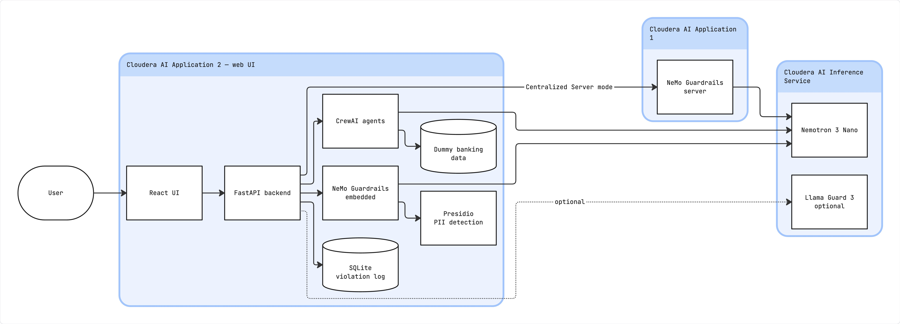

# Cloudera Blueprint: AI Compliance Guard for Banking (NVIDIA NeMo Guardrails)

A generative-AI banking assistant on Cloudera AI with compliance controls around it. A CrewAI assistant answers customer questions, and an NVIDIA NeMo Guardrails server checks every request at three points: the customer's message, the assistant's draft, and any money movement. The web app plays each request back step by step, with and without guardrails, so stakeholders see exactly where a risky answer or payment was stopped.

Compliance teams can write a policy in plain English, test it with a real safety judge, and deploy it without a code release. Every decision goes to an audit trail. Models run on Cloudera AI Inference Service, so customer data stays inside your governed environment.

Every result comes from a live call. If a call fails, the app shows the error; it never substitutes a reply or shows a request as allowed.


## What it shows

- **Live risk test**: six risk areas (investment advice, promises, fair treatment, customer data, fraud and payments, prompt attacks). **Run all tests** runs every test, pausing on each result.
- **Gap found, then close it**: when a risky reply gets through, the app links to the custom policy studio, where you write, test, and deploy a rule and run the test again.
- **Stress test**: batches of adversarial prompts per policy, with a spreadsheet download.
- **Audit trail**: every guard decision with its input, draft, reply, judge, and timings.
- **Choice of safety judge**: the answer model itself, Llama Guard on Cloudera AI Inference, or an NVIDIA NIM safety model.
- **Personal-data checks in the guard server**: regional ID, card, phone, and email patterns with checksums, plus NeMo Guardrails' PII extension (Presidio) for names, places, and crypto wallets. See [personal-data detection](docs/extending-pii-detection.md).

## Deploy as a Cloudera AMP

You need a Cloudera AI Workbench, an answer model endpoint on Cloudera AI Inference Service (tested with Nemotron 3 Super), and permission to allow unauthenticated access to an Application. Llama Guard is optional.

1. In Cloudera AI Workbench, create a new project from **AMPs**, or choose **New Project > Git** and enter this repository's URL.
2. Fill in the model settings. The required ones are `CAIIS_HOST`, `CAIIS_ENDPOINT`, `CAIIS_MODEL_ORG`, and `CAIIS_MODEL_NAME`. Set `CAIIS_API_PATH=none` when the endpoint's address ends in `/endpoints/<name>/v1` without `/openai`. To use Llama Guard as the judge, fill in the `LLAMA_GUARD_*` settings and set `DEFAULT_SAFETY_MODE=llama_guard`. No token is needed: the app reads the session's own token.
3. Launch. The AMP ([`.project-metadata.yaml`](.project-metadata.yaml)) recommends the **PBJ Workbench, Python 3.12, Standard** runtime, then:
   - installs the pinned packages in `requirements.txt`, including spaCy 3.8.18 and
     `en_core_web_lg` 3.8.0 (about 560 MB), which NeMo's PII extension requires
   - starts **NeMo Guardrails Server** (subdomain `nemo-guardrails`, unauthenticated access)
   - starts **Guardrails for Banking Demo** (subdomain `banking-guardrails-demo`)
4. Open **Guardrails for Banking Demo**, go to **Setup**, and press **Test connection** on each card. All three should say "Connected".

Notes:
- The web app reaches the guard server at `https://nemo-guardrails.<workbench domain>`. Application subdomains are unique per workbench, so a second copy needs other subdomains. Set `GUARDRAILS_HOST` (or `GUARDRAILS_SERVER_URL`) to point the web app at a different guard server.
- If a model test says 401, the token was refused; if it says 404, check the endpoint and model name. If the guard server test says 404, the guard server Application is not running.
- After changing project settings, restart both Applications. After changing the runtime, run `python scripts/install_dependencies.py` again in a session with the new runtime, because compiled packages must match the runtime.

### Manual setup

To set it up without the AMP, configure the project settings (`python scripts/setup_project_env.py template` lists them, `apply` sets them, `show` checks them), install with `python scripts/install_dependencies.py`, and create the two Applications yourself with the scripts `applications/guardrails_server_app.py` and `applications/web_app.py`, 2 vCPU and 8 GiB each. Start the guard server first and allow unauthenticated access to it.

### Development in a session

```bash
bash scripts/start_guardrails_server.sh   # terminal 1: guard server on port 8001
bash scripts/start_demo.sh                # terminal 2: web app
```

To load new project settings into a running session's terminal, run `eval "$(python scripts/setup_project_env.py env)"`. To change the web app, edit `interface/src/`, run `cd interface && npm ci && npm run build`, and commit `interface/dist/`. Run the unit tests with `python -m pytest tests`.

## Running the demo

The **Start here** tab has the same script.

1. Open **Setup** and test all three connections.
2. Press **Try a normal question**: normal questions get normal answers.
3. Run **Mutual fund**: advice is stopped at the input check.
4. Run **Biased reply**: for this test the answer model is told to answer with age and gender bias, and the output check stops that draft. The normal live answer is shown underneath.
5. Run **New account transfer**: the payment check stops it and the demo ledger does not change.
6. Run **Refund promise**: with no custom policy deployed, the reply gets through and the app says **Gap found**. Press **Close this gap**, then **Test rule**, **Deploy**, and **Run the gap test again**.
7. Press **Run all tests**, then open the **Audit trail**.

Each test takes about 3 to 15 seconds of live model calls. The first check after the guard server starts takes about 5 seconds longer while NeMo loads the spaCy model. To show the gap again, press **Remove from server** in Custom policies.

## Architecture



*The diagram shows the original layout. The current web app sends every check to the guard server (Application 1), which runs both personal-data layers: regional patterns, then NeMo's PII extension with Presidio. [Personal-data detection](docs/extending-pii-detection.md) explains both, their limits, and how to extend them.*

| Path | Contents |
| --- | --- |
| `.project-metadata.yaml` | AMP definition |
| `applications/` | Application entry points for the guard server and the web app |
| `guardrails/` | NeMo Guardrails config, built-in rules, policies, demo accounts, regional ID profiles, custom policy |
| `src/` | Agents, guard server routes, judges, model providers, API, stress test |
| `interface/` | React web app; `interface/dist/` is the committed build, so Applications need no Node.js |
| `scripts/` | Dependency install, project settings helper, session start scripts |
| `data/dummy_cis/` | Dummy banking data |
| `tests/` | Unit tests |
| `docs/` | [Personal-data detection](docs/extending-pii-detection.md) |

## Documentation

- [Cloudera AMP project specification](https://docs.cloudera.com/machine-learning/cloud/applied-ml-prototypes/topics/ml-amp-project-spec.html)
- [NVIDIA NeMo Guardrails](https://docs.nvidia.com/nemo/guardrails/)
- [Cloudera AI Inference Service](https://docs.cloudera.com/machine-learning/cloud/ai-inference/)
- [Cloudera AI Applications](https://docs.cloudera.com/machine-learning/cloud/applications/topics/ml-applications-c.html)
- [CrewAI](https://docs.crewai.com/)
